# simple-magpie

[简体中文](README.md) · **English**

A **minimal magpie**, written from scratch in Go: a local LLM gateway plus a
context-window dashboard.

- **Multi-protocol gateway**: serves OpenAI Chat, OpenAI Responses, Anthropic
  Messages and Gemini at once.
- **Protocol translation**: through a unified intermediate representation (IR),
  so any agent can use any provider.
- **Routing + failover**: provider/account pools, routing groups
  (`group/<id>`), strategies (order/rotate/usage/weighted), account cooldown,
  and session affinity (keeps the prompt cache warm).
- **Context-window dashboard**: squarified treemap, cache hit rate, headroom
  estimate, per-category breakdown — a re-implementation of magpie's
  "Context Window" page.
- **Conversation view**: per-turn transcripts with tool calls and results,
  grouped by date, collapsible, switchable by session.

## Screenshots

| Context window (treemap + cache + categories) | Conversation (per turn / date / collapse) |
| --- | --- |
| 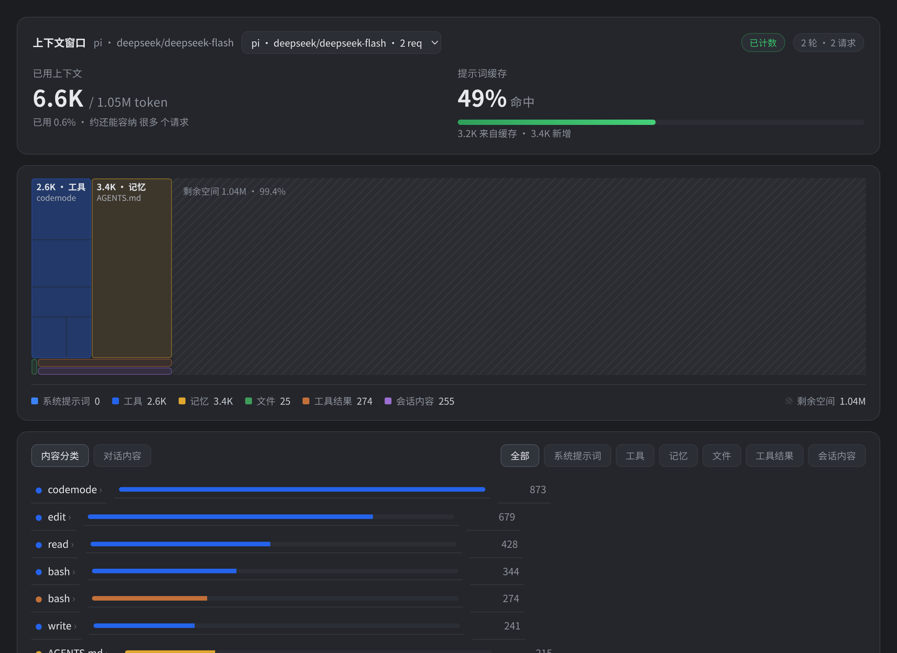 |  |

Click any category item to see its real content, auto-formatted by type:

| Source / tool output (with line numbers) | JSON (tool_call args, highlighted) |
| --- | --- |
| 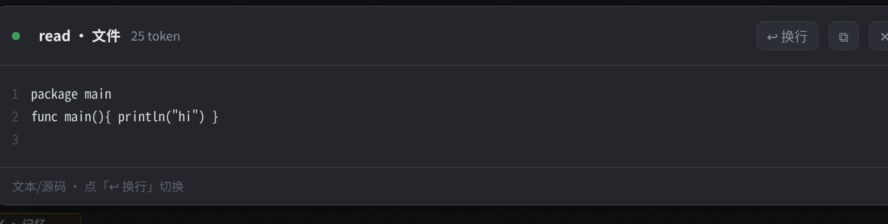 | 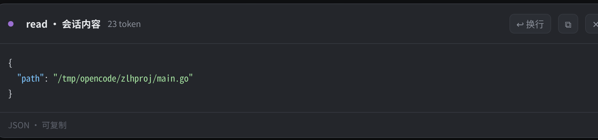 |

## Layout

```
simple-magpie/
├── cmd/simple-magpie/main.go   entry: gateway + dashboard on one port
├── config/config.json          sample config (providers/accounts/groups)
└── internal/
    ├── config/                 config load + validation
    ├── protocol/               unified IR + 4-protocol parse/build
    ├── gateway/                handle / relay / translate / record
    ├── routing/                candidate planning, strategies, cooldown, affinity
    ├── prompt/                 prompt dissection, token estimate, headroom
    ├── transcript/             IR <-> displayable conversation turns
    ├── store/                  in-memory records + per-session series
    └── web/                    dashboard (embedded HTML) + JSON API
```

## Architecture

A single binary: agents on the left speak four wire protocols, providers on the right, and in
between sits the "plan → relay/translate → record" orchestration, with a read-only dashboard
on the side.

### Layered view

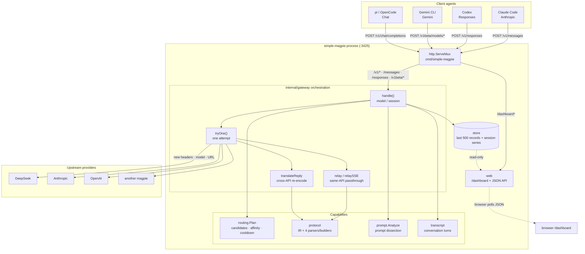

### Lifecycle of one request

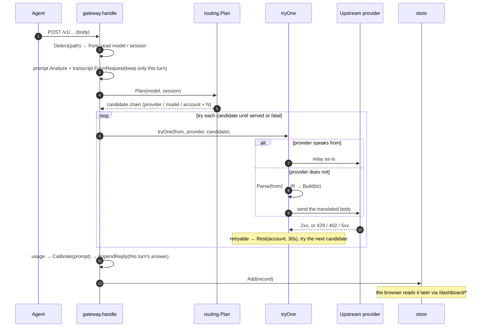

### Package dependencies (one-way, no cycles)

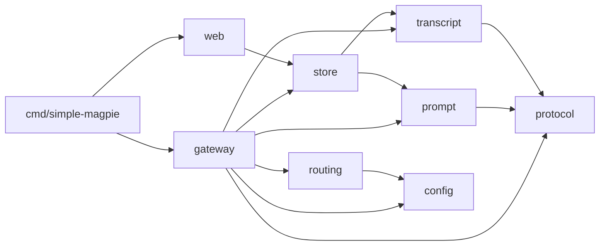

- `protocol` owns the IR and the four wire APIs, and imports no other internal package;
- `gateway` is the only orchestration layer, pulling in routing, protocol, dissection, transcripts and the store;
- `web` only reads `store`, decoupled from the gateway (they share memory in one process).

## Quick start

```bash
# 1. edit config/config.json with your provider keys
# 2. run
go run ./cmd/simple-magpie -config config/config.json
```

Listens on `127.0.0.1:3425` by default (override with `-listen`).

### Point an agent at the gateway

```bash
# OpenAI-style
export OPENAI_BASE_URL=http://127.0.0.1:3425/v1
export OPENAI_API_KEY=smagpie

# Anthropic-style
export ANTHROPIC_BASE_URL=http://127.0.0.1:3425
export ANTHROPIC_API_KEY=smagpie

# Gemini-style
export GEMINI_BASE_URL=http://127.0.0.1:3425
```

### Open the dashboard

Visit <http://127.0.0.1:3425/dashboard> after sending a few requests:

- **Used context** `162K / 1.05M`, `used 15% · ~N requests left`
- **Prompt cache** `99% hit`, `160K from cache · 1.5K new`
- **Treemap**: each block by token share, free space hatched
- **Legend**: system prompt / tools / memory / files / tool results / chat / free
- **Detail table**: filter by category; **click any row (or treemap tile) to see
  the item's real content** — JSON pretty/highlighted, source/output with line
  numbers, tool descriptions with colored sections; copyable, wrap toggle.
- **Conversation**: per-turn list, grouped by date, collapsible; each turn shows
  system / you / tool calls (formatted JSON) / tool results / thinking / assistant,
  with copy buttons. Open directly at `/dashboard#conv`.

## Configuration

```jsonc
{
  "listen": "127.0.0.1:3425",
  "default_model": "deepseek/deepseek-chat",
  "affinity": "auto",            // auto | off | strict
  "providers": [
    {
      "id": "deepseek",
      "base_url": "https://api.deepseek.com",
      "protocols": ["chat"],     // protocols this provider speaks upstream
      "default_model": "deepseek-chat",
      "weight": 1,
      "accounts": [              // multiple accounts => failover
        { "name": "main", "key": "sk-..." }
      ]
    }
  ],
  "groups": [
    {
      "id": "daily-coding",
      "strategy": "order",       // order | rotate | usage | weighted
      "members": [
        { "provider": "deepseek",  "model": "deepseek-chat" },
        { "provider": "anthropic", "model": "claude-sonnet-4-5" }
      ]
    }
  ]
}
```

Request a model as `group/<id>`, `<provider>/<model>`, or a bare model name
(matched against `default_model`).

## How it works

> Detailed **architecture / request-flow / communication diagrams** are in
> [`docs/`](docs/README.md).

### 1. Protocol translation (IR)

Each protocol has a parser (in) and a builder (out), both over a unified
`protocol.Request` / `Reply`. N protocols need N parsers + N builders instead of
N² paths.

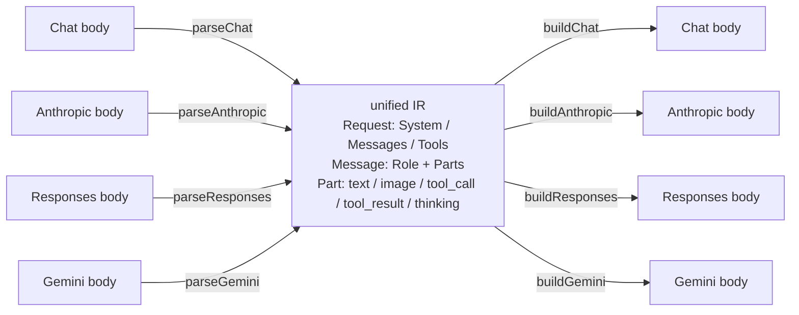

Replies work the same way: `gatherReply` folds an upstream answer into
`Reply{Text, Thinking, Calls, Usage}`, and `renderReply` renders it in the
client's protocol; streaming uses `writeTranslatedStream` to emit that
protocol's SSE events.

### 2. relay vs translate

- provider speaks the agent's protocol → **relay** as-is (keeping vendor-private
  fields), forwarding SSE line by line.
- otherwise → **translate** through the IR. This build gathers the whole upstream
  reply and re-encodes it once (correctness first); a production build can
  re-encode event by event.

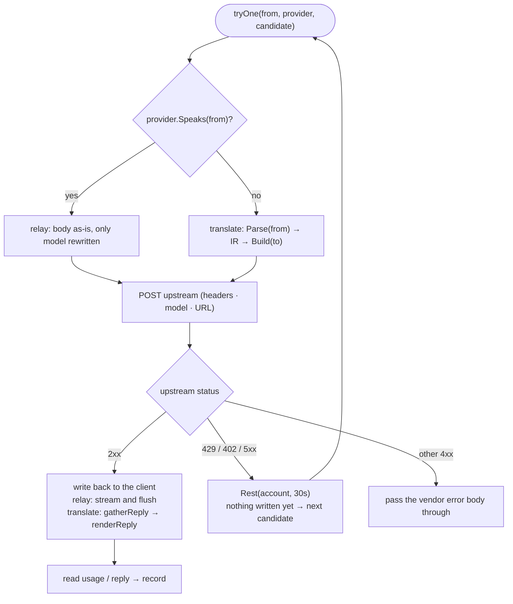

### 3. Routing & failover

`routing.Plan()` yields the candidate chain:

- a routing group expands to each member's (provider, model, account) by strategy;
- session affinity sends a conversation back to the account that last answered it
  (keeping the prompt cache warm);
- each failure (429/402/5xx) rests that account and tries the next one, until
  something answers or the chain is exhausted.

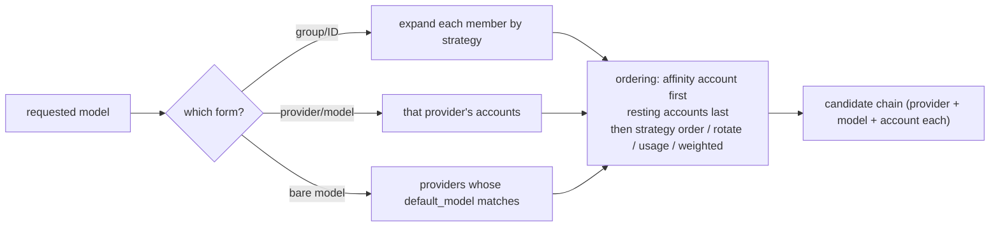

Failover state machine:

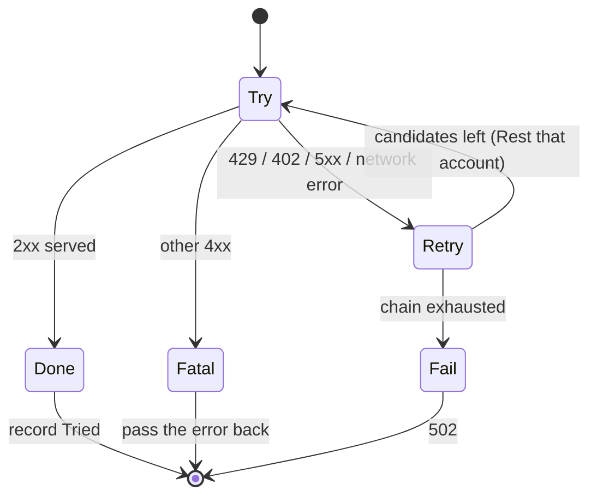

### 4. Prompt dissection (dashboard data)

`prompt.Analyze()` walks the messages and classifies each piece by source:

- **system** ← system/developer messages
- **tools** ← tool definition schemas
- **memory** ← text mentioning AGENTS.md/CLAUDE.md/reminder
- **files** ← content read in by read/view tools, images
- **results** ← other tool output (shell/bash…)
- **chat** ← what the user and model said, tool calls

Token estimate: `ASCII ≈ 4 chars/token`, `CJK ≈ 1 char/token`, image ≈ 1600.
Once the vendor's `usage` arrives it is **scaled proportionally** to the real
total and marked `counted`.

`Headroom()` uses the **median** of per-turn growth to estimate how many more
requests fit (one huge output cannot skew it).

### 5. Records & dashboard (observability)

The gateway dissects every request into a structured record while serving it; the
dashboard only reads those records — fully decoupled from the forwarding path:

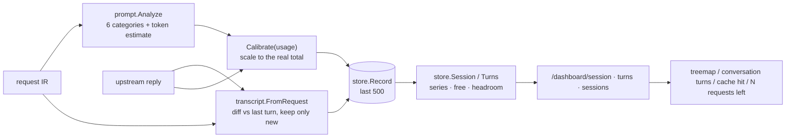

## Fixed port + LAN access

To open the dashboard from a browser by IP, listen on `0.0.0.0`. See
`config/config.public.json`:

```jsonc
{ "listen": "0.0.0.0:8080", ... }
```

```bash
go build -o bin/simple-magpie ./cmd/simple-magpie
./bin/simple-magpie -config config/config.public.json
# open http://<host-ip>:8080/dashboard
```

> Security: `0.0.0.0` exposes the gateway to everyone on the network and the
> gateway accepts any bearer token. Only do this on a trusted LAN; for public
> exposure add an authenticating reverse proxy or use `127.0.0.1` + an SSH tunnel.

## Testing with pi (provider name `zlh-simple-magpie`)

Register an OpenAI-compatible provider in `~/.pi/agent/models.json` pointing at
this gateway, then run:

```bash
pi --provider zlh-simple-magpie \
   --model zlh-simple-magpie/deepseek/deepseek-flash \
   --session-id demo --print --name zlh-simple-magpie \
   "Use the bash tool to run 'echo hi && ls', then summarize."
```

Open `/dashboard#conv` to see the per-turn transcript with tool calls/results.

## API

| Path | Description |
| --- | --- |
| `GET /dashboard` | Dashboard page (`#conv` opens the conversation) |
| `GET /dashboard/session?session=` | Context stats for one session (treemap data) |
| `GET /dashboard/turns?session=` | Per-turn items + tokens |
| `GET /dashboard/transcript?session=` | Flattened transcript |
| `GET /dashboard/sessions` | All sessions (for the switcher) |
| `GET /dashboard/recent?n=` | Recent requests |

Gateway endpoints: `/v1/chat/completions`, `/v1/responses`, `/v1/messages`,
`/v1beta/models/{model}:generateContent`, `GET /v1/models`.

## Differences from magpie

This is a teaching/demo implementation; deliberately simplified:

- streaming translation gathers then re-encodes (not event-by-event);
- no plugin system, masking, subscription bridge or persistence;
- basic routing strategies (no nested groups / intent routing / quota windows);
- context windows use a small built-in table (not models.dev).

But the **gateway core (multi-protocol, IR translation, routing, failover) and
the context-window dashboard** are fully runnable.

## License

MIT
