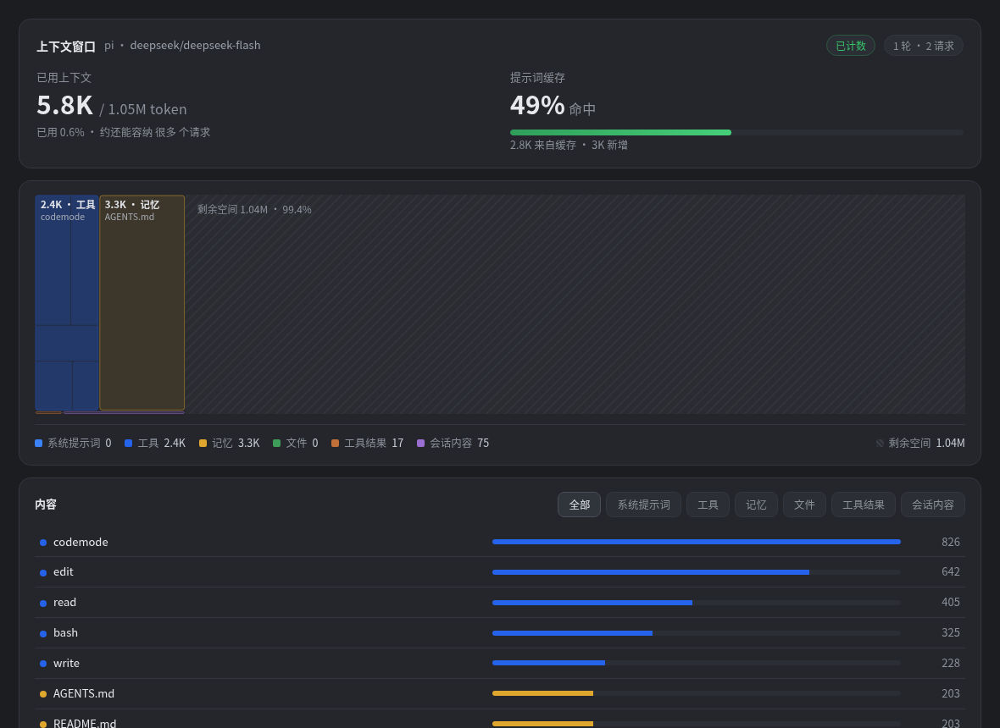

# simple-magpie

一个用 Go 从零实现的**简化版 magpie**:本地 LLM 网关 + 上下文窗口仪表盘。

- **多协议网关**:同时服务 OpenAI Chat、OpenAI Responses、Anthropic Messages、Gemini 四种 API。
- **协议互转**:经统一中间表示 (IR) 在不同协议间转换,让任意 Agent 用任意 provider。
- **路由 + 故障转移**:provider/账号池、路由组 (`group/<id>`)、策略 (order/rotate/usage/weighted)、账号冷却、会话亲缘 (prompt cache)。
- **上下文窗口仪表盘**:树状矩形 (treemap)、缓存命中、剩余请求估算、按分类明细 —— 复刻 magpie 的「上下文窗口」页。

## 目录结构

```
simple-magpie/
├── cmd/simple-magpie/main.go   程序入口,挂网关 + 仪表盘
├── config/config.json          示例配置(providers/accounts/groups)
└── internal/
    ├── config/                 配置加载与校验
    ├── protocol/               统一 IR + 四协议的 parse/build
    │   ├── chat.go             OpenAI Chat
    │   ├── anthropic.go        Anthropic Messages
    │   ├── responses.go        OpenAI Responses
    │   └── gemini.go           Gemini
    ├── prompt/                 prompt 解剖:分类/token 估算/缓存/headroom
    ├── routing/                候选规划、策略、冷却、会话亲缘
    ├── store/                  最近请求 + 会话序列(内存)
    ├── gateway/                网关:handle / relay / translate / 记录
    └── web/                    仪表盘(dashboard.html 内嵌)
```

## 快速开始

```bash
# 1. 编辑 config/config.json,填入你的 provider key
# 2. 运行
go run ./cmd/simple-magpie -config config/config.json
```

默认监听 `127.0.0.1:3425`。用 `-listen` 覆盖。

### 把 Agent 指向网关

```bash
# OpenAI 系
export OPENAI_BASE_URL=http://127.0.0.1:3425/v1
export OPENAI_API_KEY=smagpie

# Anthropic 系
export ANTHROPIC_BASE_URL=http://127.0.0.1:3425
export ANTHROPIC_API_KEY=smagpie

# Gemini 系
export GEMINI_BASE_URL=http://127.0.0.1:3425
```

### 打开仪表盘

浏览器访问 <http://127.0.0.1:3425/dashboard>,发几个请求后即可看到:

- **已用上下文** `162K / 1.05M`、`已用 15% · 约还能容纳 N 个请求`
- **提示词缓存** `99% 命中`、`160K 来自缓存 · 1.5K 新增`
- **树状矩形**:每块按 token 占比,剩余空间斜线填充
- **图例**:系统提示词 / 工具 / 记忆 / 文件 / 工具结果 / 会话内容 / 剩余空间
- **明细表**:按分类筛选,每行一个文件/工具及其占比
- **对话内容**:切到「对话内容」tab,按**对话轮次**展示(对齐 magpie 原版)——
  每轮一行 `第 N 轮 · 时间 · token`,点击展开该轮的全部内容:系统提示词、你的消息、
  **工具调用**(工具名 + 格式化 JSON)、**工具结果**(真实输出)、思考、助手回复,
  每块都有复制按钮;按日期分组,右上「全部展开 / 全部折叠」。

- **按日期分组**:对话按 `今天/昨天/YYYY-MM-DD` 分隔显示;
- **会话切换**:顶部下拉框可选择不同会话,各自看自己的对话与工具调用;
- **可折叠**:每条消息带时间,长消息默认折叠,点击展开;右上「全部展开 / 全部折叠」。

> 对话视图直链:`http://<IP>:<端口>/dashboard#conv`(会话取最近一次)。
> 每个请求的转写由网关在服务时捕获(I R 解析请求 + 解析回复),按会话聚合到内存,
> 单字段上限 8KB(超出标「已截断」),不落盘。

## 配置说明

```jsonc
{
  "listen": "127.0.0.1:3425",
  "default_model": "deepseek/deepseek-chat",
  "affinity": "auto",            // auto | off | strict:会话粘连到上次回答的账号
  "providers": [
    {
      "id": "deepseek",
      "base_url": "https://api.deepseek.com",
      "protocols": ["chat"],     // 该 provider 上游支持哪些协议
      "default_model": "deepseek-chat",
      "weight": 1,
      "accounts": [              // 多账号 => 故障转移
        { "name": "main", "key": "sk-..." }
      ]
    }
  ],
  "groups": [
    {
      "id": "daily-coding",
      "strategy": "order",       // order | rotate | usage | weighted
      "members": [
        { "provider": "deepseek", "model": "deepseek-chat" },
        { "provider": "anthropic", "model": "claude-sonnet-4-5" }
      ]
    }
  ]
}
```

请求模型可写:`group/<id>`、`<provider>/<model>`、裸模型名(按 default_model 匹配)。

## 工作原理

> 详细的**架构图 / 请求流程图 / 各子系统原理图**见 [`docs/`](docs/README.md)。
> 下面对应各图做简要说明。

### 1. 协议互转 (IR)

每个协议各有 parse(入)和 build(出),都经过统一的 `protocol.Request` / `protocol.Reply`:

```
请求 body ──parse(from)──▶ IR ──build(to)──▶ 上游 body
上游 reply ──parse(to)──▶ Reply ──render(from)──▶ 客户端
```

这样 N 种协议只需 N 个解析器 + N 个渲染器,而不是 N² 条转换路径。

### 2. relay vs translate

- provider 支持 Agent 的协议 → **relay** 原样转发(保留厂商私有字段),SSE 边收边转。
- provider 不支持 → **translate** 走 IR 转换。当前实现把上游回复聚合后一次性渲染(正确优先);生产版可按事件流式重编码。

### 3. 路由与故障转移

`routing.Plan()` 产出候选链:
- 路由组按策略展开为各成员的 (provider, model, account);
- 会话亲缘让同一对话优先回到上次回答的账号(保住 prompt cache);
- 每个候选失败(429/402/5xx)时休息该账号并尝试下一个,直到有结果或耗尽。

### 4. prompt 解剖 (仪表盘数据)

`prompt.Analyze()` 遍历消息,按来源归类并累计 token:
- **系统提示词** ← system/developer 消息
- **工具** ← 工具定义 schema
- **记忆** ← 含 AGENTS.md/CLAUDE.md/reminder 的文本
- **文件** ← read/view 类工具读入的内容、图片
- **工具结果** ← shell/bash 等输出
- **会话内容** ← 用户与模型的话、工具的调用

token 估算:`ASCII ≈ 4 字符/token`,`CJK ≈ 1 字/token`,图片 ≈ 1600。拿到厂商 `usage` 后按真实总量**等比校准**并标记 `counted`。

`Headroom()` 用相邻轮次增量的**中位数**估算还能容纳多少请求(避免单次超大输出拉偏)。

## 用 pi 测试(provider 名 `zlh-simple-magpie`)

[pi](https://github.com/badlogic/pi-mono) 是支持自定义 OpenAI 兼容 provider 的终端 Agent。
用一个名为 `zlh-simple-magpie` 的 provider 指向本网关即可端到端验证。

**1. 启动网关**(示例:上游指向一个已在跑的 provider / 另一个网关):

```jsonc
// /tmp/zlh.json
{
  "listen": "127.0.0.1:3516",
  "affinity": "auto",
  "providers": [
    { "id": "magpie", "base_url": "http://127.0.0.1:3425", "protocols": ["chat"],
      "default_model": "deepseek/deepseek-flash",
      "accounts": [{ "name": "main", "key": "magpie" }] }
  ]
}
```

```bash
go run ./cmd/simple-magpie -config /tmp/zlh.json
```

**2. 在 pi 里加 provider**(`~/.pi/agent/models.json` 的 `providers` 下加一项):

```json
"zlh-simple-magpie": {
  "api": "openai-completions",
  "apiKey": "smagpie",
  "baseUrl": "http://127.0.0.1:3516/v1",
  "name": "zlh simple-magpie",
  "compat": { "sendSessionAffinityHeaders": true },
  "models": [{
    "id": "deepseek/deepseek-flash",
    "name": "DeepSeek Flash (via zlh-simple-magpie)",
    "input": ["text"],
    "contextWindow": 1048576,
    "maxTokens": 8192,
    "cost": { "input": 0, "output": 0, "cacheRead": 0, "cacheWrite": 0 }
  }]
}
```

**3. 用 pi 跑一轮(带工具和上下文文件):**

```bash
mkdir -p /tmp/zlhproj && cd /tmp/zlhproj
printf '# AGENTS.md\nThe user is zlh. Prefer short answers.\n' > AGENTS.md
printf 'package main\nfunc main(){ println("hi") }\n' > main.go

pi --provider zlh-simple-magpie \
   --model zlh-simple-magpie/deepseek/deepseek-flash \
   --no-session --print --name zlh-simple-magpie \
   "Use the bash tool to run 'echo hello-from-pi && ls', then summarize the files."
```

**4. 打开仪表盘** <http://127.0.0.1:3516/dashboard>,会看到这次 pi 请求的解剖:

- `pi · deepseek/deepseek-flash` · 已用 5.8K / 1.05M · 缓存 49% 命中
- 树状矩形:**工具 2.4K**(codemode/edit/read/bash/write)+ **记忆 3.3K**(AGENTS.md/README.md)+ 剩余空间斜线块
- 明细表:codemode 826 / edit 642 / read 405 / bash 325 / write 228 / AGENTS.md 203 …



> 说明:网关自动按 User-Agent 把 pi 识别为 agent `pi`,并按会话 header 归并同一对话的多个请求,
> 因此缓存命中、剩余请求数(中位数增长法)都基于该会话的真实序列计算。


这是教学/演示用的简化实现,刻意省略了 magpie 的大量工程细节:

- 流式转换目前是「聚合后重编码」,非逐事件;
- 无插件系统、无脱敏、无订阅桥接、无持久化;
- 路由策略是基础版,无嵌套组/意图路由/额度窗口;
- 模型上下文窗口用内置表近似,未接 models.dev。

但**网关核心(多协议、IR 互转、路由、故障转移)与上下文窗口仪表盘**都是完整可运行的。

## 固定端口 + 局域网 IP 访问

想用浏览器按 IP 打开仪表盘,让网关监听 `0.0.0.0`(所有网卡)。项目自带 `config/config.public.json`:

```jsonc
{
  "listen": "0.0.0.0:8080",       // 固定端口 8080,监听所有网卡
  "affinity": "auto",
  "providers": [
    { "id": "magpie", "base_url": "http://127.0.0.1:3425", "protocols": ["chat"],
      "default_model": "deepseek/deepseek-flash",
      "accounts": [{ "name": "main", "key": "magpie" }] }
  ],
  "groups": []
}
```

```bash
go build -o bin/simple-magpie ./cmd/simple-magpie
./bin/simple-magpie -config config/config.public.json
# 或覆盖端口:  ./bin/simple-magpie -config config/config.public.json -listen 0.0.0.0:8080
```

用本机 IP 打开仪表盘:

```
http://<本机IP>:8080/dashboard
```

查本机 IP:`hostname -I` 或 `ip -4 addr`。例如本机 `192.168.1.175` → <http://192.168.1.175:8080/dashboard>。

> 安全提示:`0.0.0.0` 会让**同一网络内任何人都能访问**网关与仪表盘。
> 网关接受任意 bearer token(`smagpie`),所以只在你信任的局域网内这样开;
> 公网暴露请在前面加带认证的反向代理,或把 listen 改回 `127.0.0.1` 用 SSH 隧道访问。

防火墙开放端口(若开了防火墙):

```bash
sudo firewall-cmd --add-port=8080/tcp --permanent && sudo firewall-cmd --reload   # firewalld
# 或 sudo ufw allow 8080/tcp                                                       # ufw
```

## 与 magpie 的差距

这是教学/演示用的简化实现,刻意省略了 magpie 的大量工程细节:

- 流式转换目前是「聚合后重编码」,非逐事件;
- 无插件系统、无脱敏、无订阅桥接、无持久化;
- 路由策略是基础版,无嵌套组/意图路由/额度窗口;
- 模型上下文窗口用内置表近似,未接 models.dev。

但**网关核心(多协议、IR 互转、路由、故障转移)与上下文窗口仪表盘**都是完整可运行的。

## 测试

```bash
go test ./...
```

## API 一览

| 路径 | 说明 |
| --- | --- |
| `GET /dashboard` | 仪表盘页面(可用 `#conv` 直开对话视图) |
| `GET /dashboard/session?session=` | 单会话的上下文统计(treemap 数据) |
| `GET /dashboard/turns?session=` | 单会话按轮次(items + token) |
| `GET /dashboard/transcript?session=` | 单会话拍平的完整转写 |
| `GET /dashboard/sessions` | 所有会话列表(下拉框) |
| `GET /dashboard/recent?n=` | 最近请求 |

- 每一轮(请求)只存它**新增**的消息(与上一请求的 delta),所以每轮内容不重复;
- 轮次按请求时间归到「今天 / 昨天 / YYYY-MM-DD」;
- 单字段 8KB 上限,超出标「已截断」;内存保存,不落盘。
