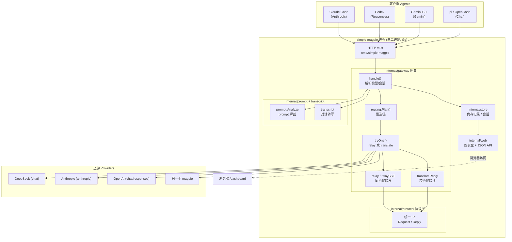
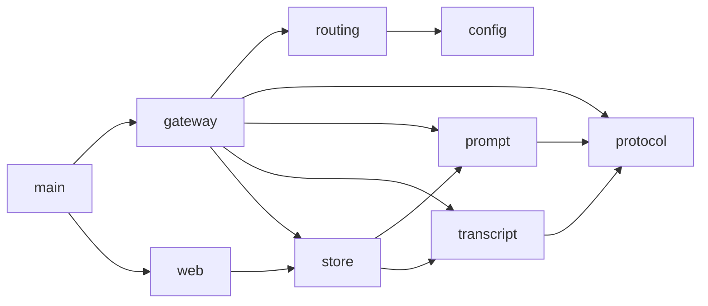
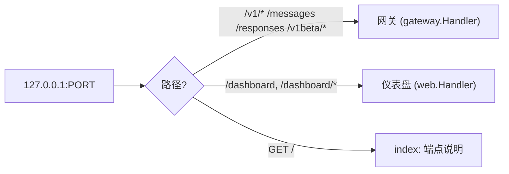

# 总体架构

## 1. 分层视图

## 2. 包职责

| 包 | 路径 | 职责 |
| --- | --- | --- |
| `main` | `cmd/simple-magpie` | 入口:加载配置,把网关与仪表盘挂到同一个端口 |
| `config` | `internal/config` | 读取 `providers / accounts / groups` JSON,校验 |
| `protocol` | `internal/protocol` | 统一 IR + 四协议 `Parse`/`Build`/`Detect`/`UpstreamPath` |
| `gateway` | `internal/gateway` | HTTP 处理、候选循环、relay/translate、记录 |
| `routing` | `internal/routing` | 候选规划、策略、账号冷却、会话亲缘 |
| `prompt` | `internal/prompt` | prompt 解剖、token 估算、缓存命中、headroom |
| `transcript` | `internal/transcript` | IR ⇄ 可展示的对话 turns |
| `store` | `internal/store` | 内存保存请求记录与会话序列、按轮次聚合 |
| `web` | `internal/web` | 内嵌仪表盘页面 + `/dashboard/*` JSON API |

## 3. 依赖方向(单向,无环)

- 核心 `protocol` 只依赖标准库(以及 `prompt`/`transcript` 反向使用它的 IR,但 `protocol` 不依赖它们)。
- `gateway` 是编排层,汇集所有能力。
- `web` 只读 `store`,与网关解耦(共用同一进程)。

## 4. 运行时同时服务两条路径

网关自身处理的端点:

| 端点 | 协议 |
| --- | --- |
| `POST /v1/chat/completions` | OpenAI Chat |
| `POST /v1/responses` | OpenAI Responses |
| `POST /v1/messages` | Anthropic Messages |
| `POST /v1beta/models/{model}:generateContent` | Gemini |
| `GET /v1/models` | 模型列表 |
