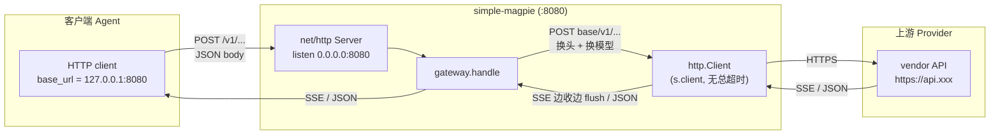
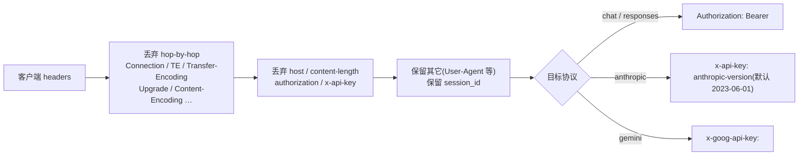
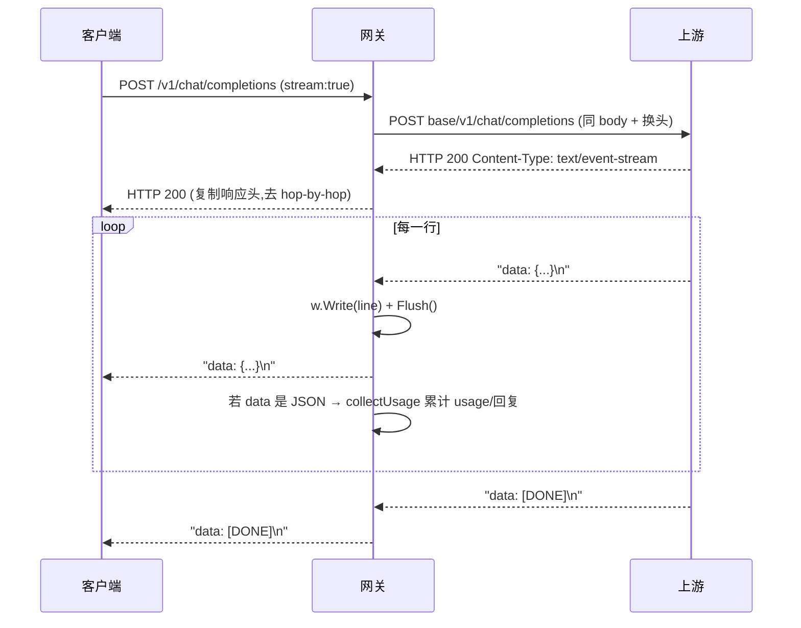
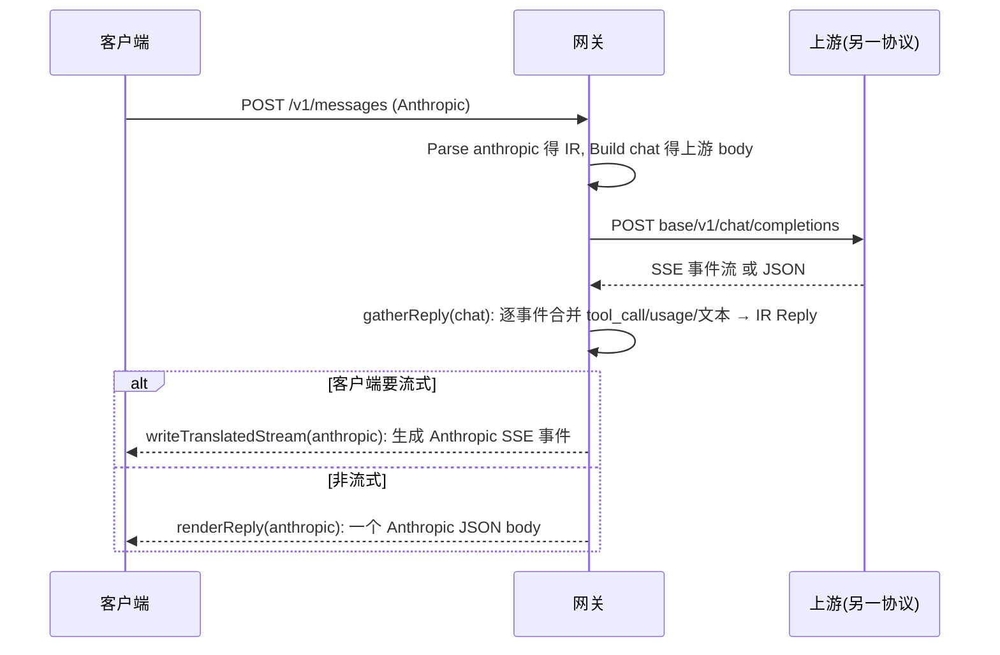
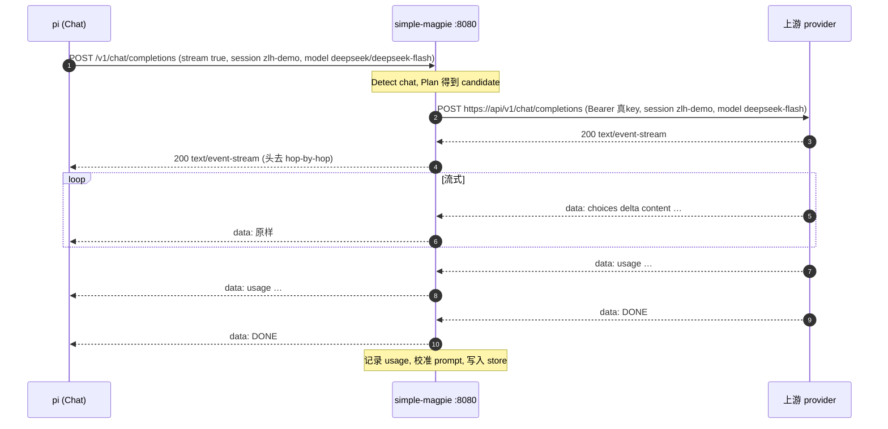
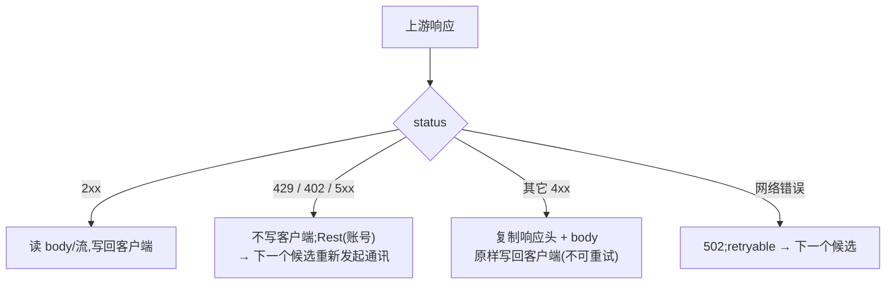

# 通讯流程图(线级)

本篇讲 **字节怎么走**:客户端 ↔ simple-magpie ↔ 上游 provider 之间的 HTTP 请求/响应、
Header 如何变换、SSE 事件流如何中转与改写。区别于 [request-flow.md](request-flow.md)
(讲函数调用顺序),这里讲**网络通讯**。

## 1. 通讯拓扑

- 客户端连的是 **本地回环**(或监听 0.0.0.0 时的本机 IP),不直连厂商。
- 网关用 `http.Client` 出站到上游;`Timeout=0`(流式可能很久)。
- 上游的连接由 `transport` 复用(默认 keep-alive / HTTP2)。

## 2. 入站 → 出站:请求行的变化

```mermaid
flowchart TB
  In["客户端请求行<br/>POST /v1/messages"] --> Det["protocol.Detect(path) → from=anthropic"]
  Det --> To{"provider 支持 from?"}
  To -->|支持| RelayUrl["出站路径 = 同协议<br/>base + /v1/messages"]
  To -->|不支持| TransUrl["出站路径 = 目标协议<br/>base + /v1/chat/completions"]
  RelayUrl --> Body1["body 原样(仅改写 model)"]
  TransUrl --> Body2["Parse(from)→IR→Build(to)<br/>生成新 body"]
  style RelayUrl fill:#2b3a2b
  style TransUrl fill:#3a2f2b
```

出站 URL 规则(`protocol.UpstreamPath`):

| 目标协议 | 路径 |
| --- | --- |
| Chat | `{base}/v1/chat/completions` |
| Responses | `{base}/v1/responses` |
| Anthropic | `{base}/v1/messages` |
| Gemini | `{base}/v1beta/models/{model}:generateContent` 或 `:streamGenerateContent?alt=sse` |

## 3. Header 变换(`copyHeaders`)

要点:
- **凭据不转发**:客户端的 `Authorization`/`x-api-key` 被丢弃,换成该 provider/账号的 key。
- **hop-by-hop 头不转发**,避免连接语义错乱。
- `session_id`(及 `X-Magpie-Session`)用于会话识别,会带到上游。

## 4. relay 通讯(同协议):SSE 逐行中转

当 provider 支持客户端协议时,**原样转发**,并按行透传、边读边 flush:

- **字节级透传**:除了读 usage,不改内容,保真度最高。
- 每个 `data:` 行,若以 `{` 开头,喂给 `collectUsage` 抽取 token 与回复(供仪表盘)。

## 5. translate 通讯(跨协议):聚合后重编码

provider 不支持客户端协议时,先把上游回复读全(或读完整流),翻译成客户端协议再发:

> 当前实现是「聚合后重编码」,正确优先;`mergeReplyCalls` 按 id/index 合并流式工具调用分片。
> 生产版可改逐事件重编码以降低首字延迟。

## 6. 一次完整通讯(真实接线示例)

以 `pi → 网关 → 上游` 为例:

## 7. 非流式 vs 流式对照

| | 非流式 | 流式 (SSE) |
| --- | --- | --- |
| Content-Type(响应) | `application/json` | `text/event-stream` |
| 传输方式 | 整体读入内存后写出 | 逐行读写 + `Flush()` 立即下发 |
| relay | 读整包 JSON → usageOf | relaySSE 逐行透传 → collectUsage |
| translate | gatherReply 后 renderReply | gatherReply 聚合 → writeTranslatedStream |
| 连接时长 | 短 | 长(可能数分钟;`Timeout=0`) |

## 8. 错误与重试的通讯表现

- 可重试失败**发生在写任何字节给客户端之前**,因此换候选不会半截输出。
- 不可重试(如 400 参数错)原样透传厂商错误体,便于 Agent 定位。
