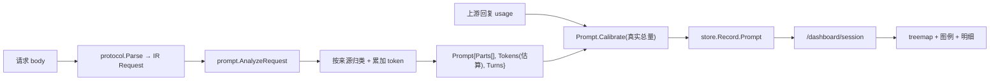
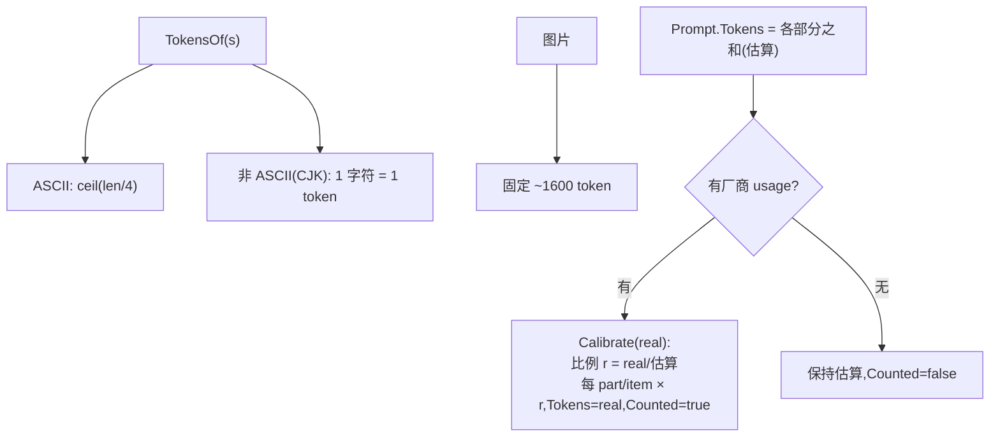
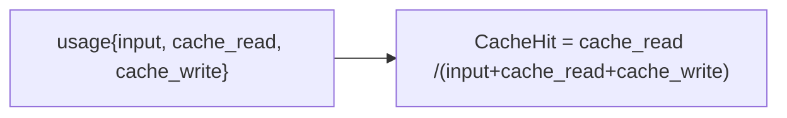
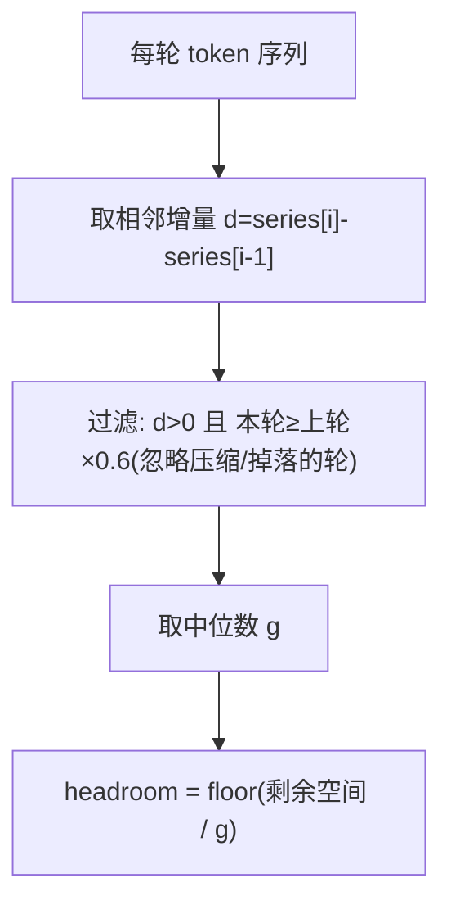
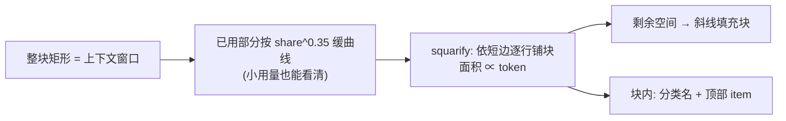
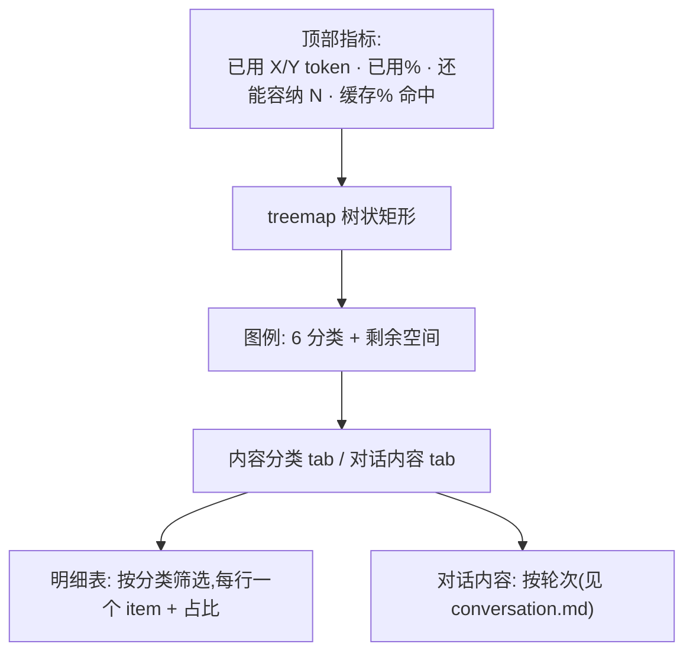

# 上下文窗口仪表盘原理

## 1. 数据从哪来

## 2. prompt 解剖:6 个分类

`prompt.AnalyzeRequest` 遍历 IR 消息,把每块内容按**来源**归类:

| 分类 (kind) | 来源 | 判定 |
| --- | --- | --- |
| `system` 系统提示词 | system/developer 消息 | 默认 |
| `tools` 工具 | 工具定义 (name+desc+schema) | 每个工具一项 |
| `memory` 记忆 | 含 `AGENTS.md`/`CLAUDE.md`/`memory`/`<reminder>` 的文本 | `classifyText` |
| `files` 文件 | `read`/`view`/`grep`/`context7` 等工具的结果、图片 | `readsFile` |
| `results` 工具结果 | shell/bash 等工具的其它输出 | 其余工具结果 |
| `chat` 会话内容 | 用户与模型的话、模型的调用 | 剩余文本/调用 |

每个分类内按 item(文件名/工具名)聚合,最大的 24 个保留,其余折叠成「另外 N 项」。

## 3. token 估算与校准

## 4. 缓存命中

仪表盘右上的「提示词缓存 48% 命中 / 2.9K 来自缓存 · 3.1K 新增」即来自这里。

## 5. 剩余请求数 (`headroom`)

用该会话每轮 token 的**相邻增量中位数**估算还能问几轮:

中位数抗异常:某轮超大的工具输出不会把估算拉偏。

## 6. treemap 布局

`squarify` 用 squarified-treemap 算法,把矩形按 token 占比切块:

## 7. 页面结构

