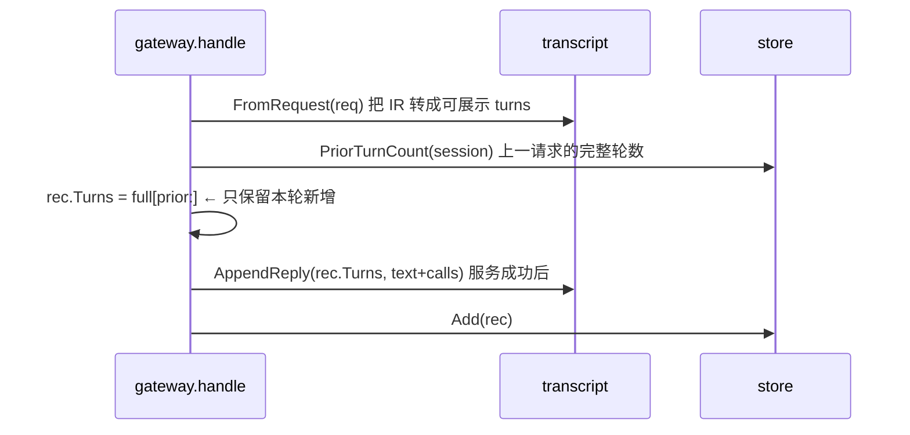
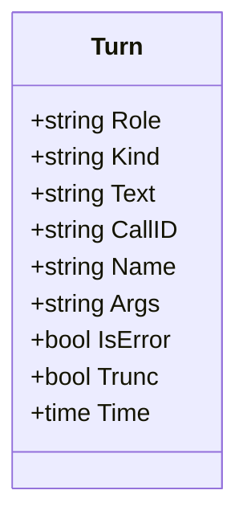
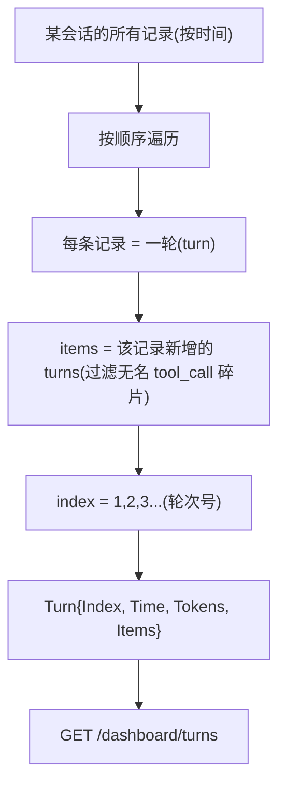
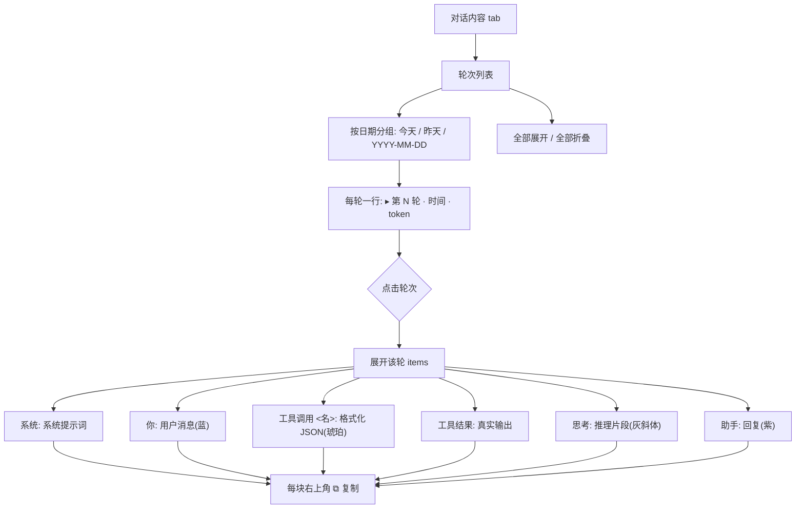

# 对话内容视图原理

## 1. 转写捕获

对话由两部分拼成:**请求携带的消息** + **本请求的回复**。

**为什么存增量**:Agent 每轮都会把**完整历史**重新发来。若每轮都存全量,仪表盘会重复显示整段历史。
用与上一请求的 diff(`prior` = 上条的 `AllCount`),本轮只留新增的消息 + 本轮回复,轮次 token 也才准确。

## 2. 转写数据模型

`transcript.FromRequest` 按 IR `Part.Kind` 映射:
`text→text`、`thinking→thinking`、`tool_call→tool_call`、`tool_result→tool_result`(role 记为 `tool`)。

## 3. 存储聚合 (`store.Turns`)

`Tokens` 来自该记录的 `Prompt.Tokens`(已按 usage 校准)。

## 4. 前端展示

## 5. 关键交互

| 交互 | 实现 |
| --- | --- |
| 切换会话 | 顶部下拉 `/dashboard/sessions` → 选 `session` |
| 按日期分组 | `dayOf(time)` → 今天/昨天/日期 |
| 折叠轮次 | `openTurn` 记录当前展开的轮次号;点击表头切换 |
| 复制内容 | `navigator.clipboard.writeText`,按钮临时变 ✓ |
| 直链 | `#conv` 直接打开对话视图 |
