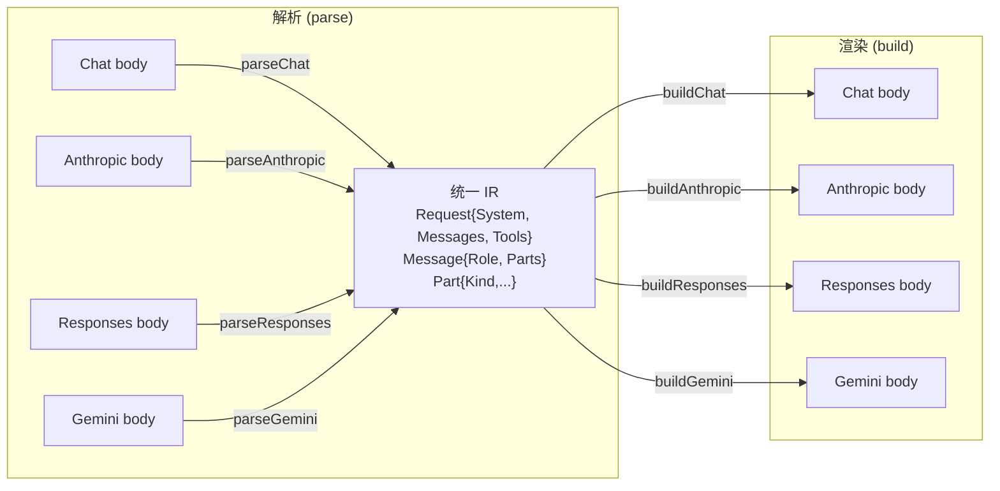
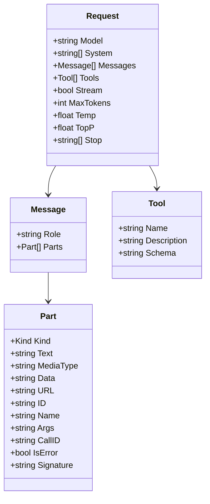
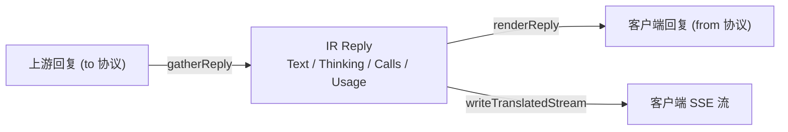

# 统一中间表示 (IR) 与协议互转

## 1. 为什么需要 IR

四种线协议的字段各不相同:

- **OpenAI Chat**:`messages[].role/content/tool_calls`,tool 结果在 `role:"tool"` 消息里。
- **OpenAI Responses**:`input` 是 item 列表(`message` / `function_call` / `function_call_output`)。
- **Anthropic Messages**:`system` 单独,`content` 是 block 数组(`text` / `tool_use` / `tool_result` / `thinking`)。
- **Gemini**:`contents[].parts[]`,`role` 是 `user/model`,工具是 `functionCall` / `functionResponse`。

如果两两互转,需要 N×(N-1) 条路径。引入 IR 后:**N 个解析器 + N 个渲染器**,线性增长。

## 2. IR 结构

**`Part.Kind` 五类**,覆盖所有协议的语义:

| Kind | 含义 | 承担字段 |
| --- | --- | --- |
| `text` | 普通文本 | `Text` |
| `image` | 图片 | `MediaType`/`Data`/`URL` |
| `tool_call` | 模型请求调用工具 | `ID`/`Name`/`Args` |
| `tool_result` | 工具返回 | `CallID`/`Text`/`IsError` |
| `thinking` | 推理/思考 | `Text`/`Signature` |

## 3. 双向应答 (Reply)

回复也一样先归一,再渲染:

`gatherReply` 在 `to` 协议下:
- 非流式:整包 JSON → `parseReplyJSON`。
- 流式:逐 `data:` 事件 → `parseReplyDelta`,**按 id/index 合并 tool_call 增量**、拼接文本、读取 usage。

## 4. 协议差异对照(转换时的注意点)

| 语义 | Chat | Anthropic | Responses | Gemini |
| --- | --- | --- | --- | --- |
| 系统提示 | `role:"system"` 消息 | 顶层 `system` | `instructions` | `systemInstruction` |
| 工具定义 | `tools[].function` | `tools[].input_schema` | `tools[].parameters` | `tools[].functionDeclarations` |
| 工具调用 | `message.tool_calls[]` | `content[] type=tool_use` | item `function_call` | `part.functionCall` |
| 工具结果 | `role:"tool"` 消息 | `content[] type=tool_result` | item `function_call_output` | `part.functionResponse` |
| 结束原因 | `finish_reason` | `stop_reason` | `status/incomplete_details` | `finishReason` |
| 角色映射 | user/assistant | user/assistant | user/assistant | user/**model** |

> 这些差异在 `parseXxx` / `buildXxx` 里逐项处理。`Detect(path)` 决定入协议,
> `UpstreamPath(base, proto, model, stream)` 决定出协议的 URL。
