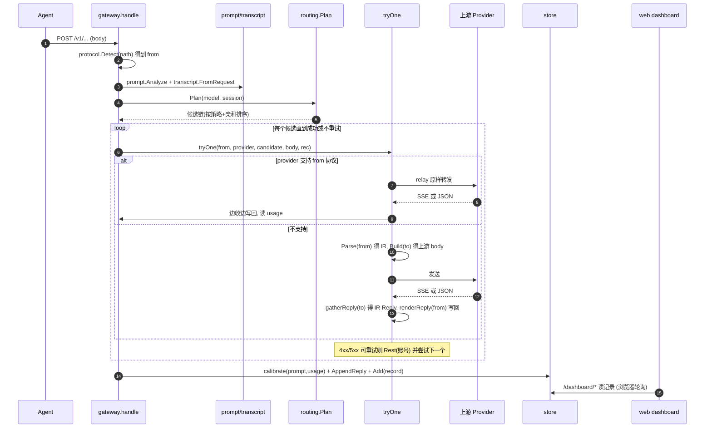
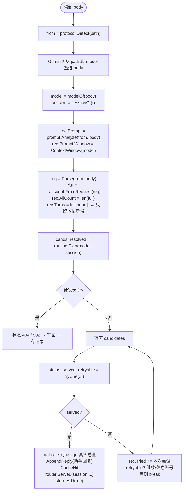
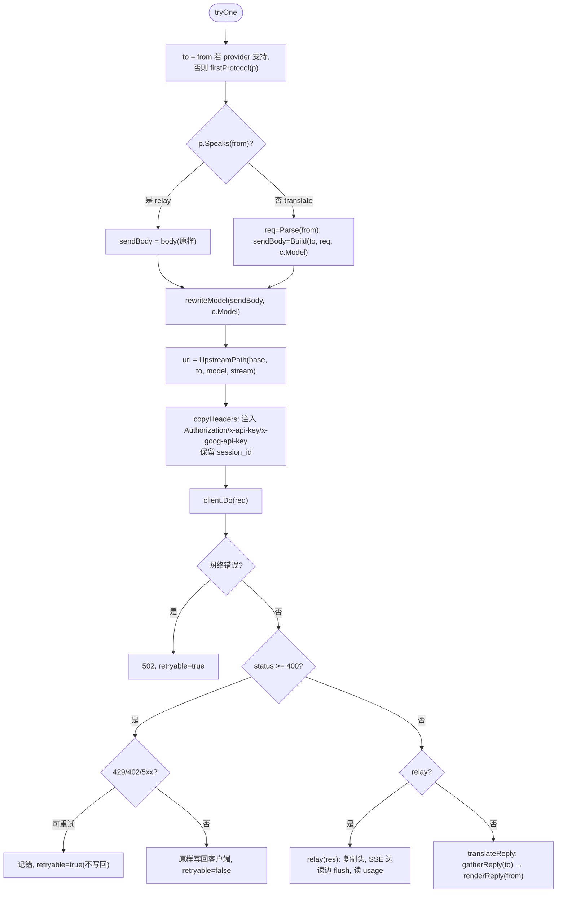
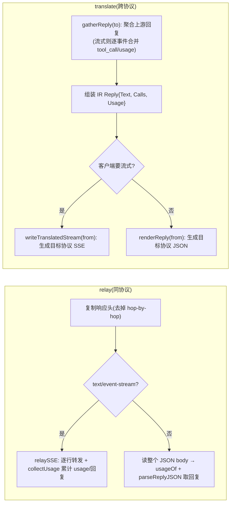

# 一次请求的完整流程

## 1. 总时序

## 2. `handle()` 内部步骤

## 3. `tryOne()` 内部步骤

## 4. relay 与 translate 的返回处理

## 5. 关键设计取舍

| 点 | 选择 | 原因 |
| --- | --- | --- |
| relay vs translate | 能原生就 relay | 保留厂商私有字段(缓存断点、原生搜索、sealed 内容) |
| 翻译的流式 | 先聚合再重编码 | 正确优先;生产版可改逐事件重编码 |
| prompt 计数 | 估算 + 厂商 usage 校准 | 没有 usage 时也能显示;有则等比缩放到真值 |
| 会话识别 | session header,否则空 | 同会话多请求才能画序列/算 headroom |
| 每轮转写 | 存增量(与上一请求 diff) | 避免整段历史重复,轮次 token 准确 |
