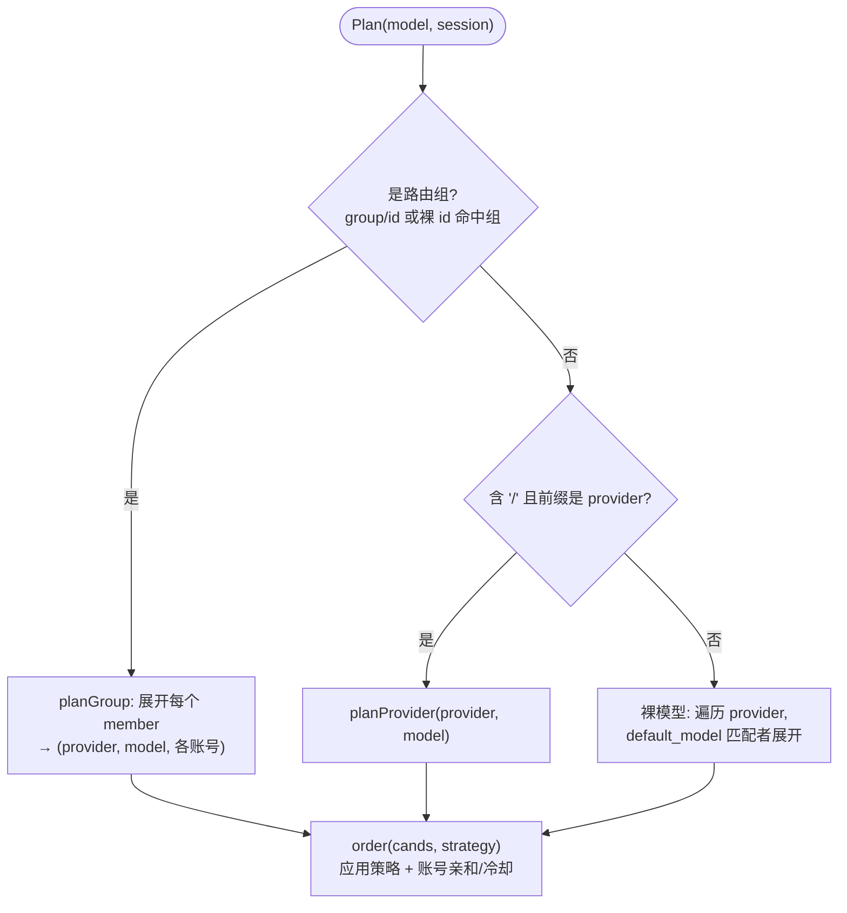
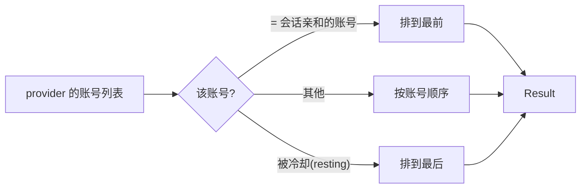
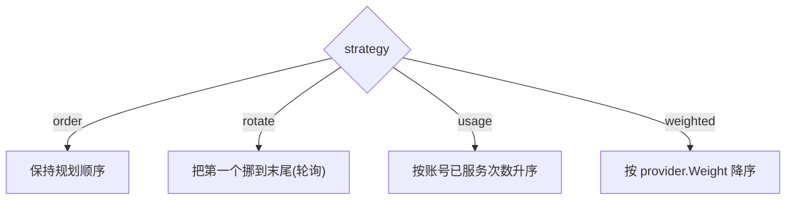
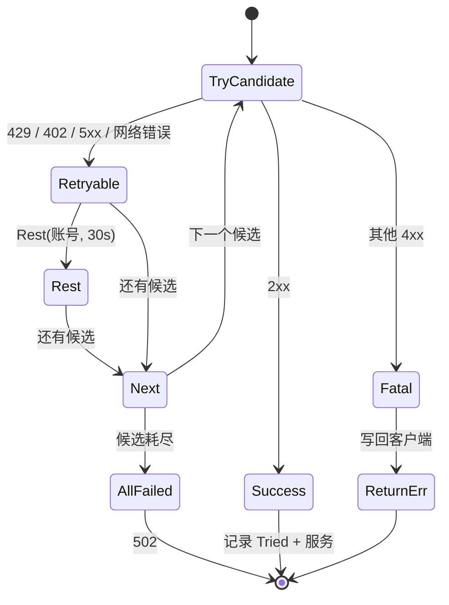
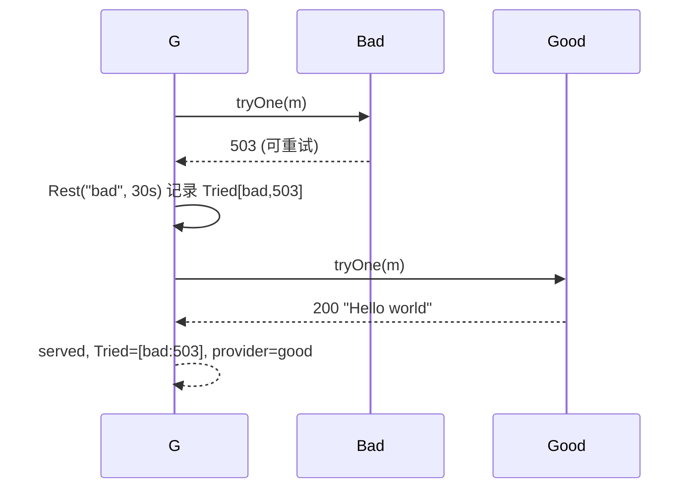

# 路由与故障转移

## 1. 候选规划 (`routing.Plan`)

一个模型名可能是:路由组 `group/<id>`、`<provider>/<model>`、或裸模型名。规划把它们展开成一条**候选链**。



## 2. 账号展开与亲和/冷却

每个 provider 展开成「每个账号一个候选」。顺序:



- **会话亲缘 (affinity)**:`Served(session, provider, account)` 记住会话上次由谁回答,
  `providerCandidates` 把该账号提前 → 保住厂商的 **prompt cache**。
- **冷却 (rest)**:某个账号 429/402/5xx 失败后 `Rest(30s)`,后续请求先避开它。

## 3. 策略 (`order`)



## 4. 故障转移循环




记录里 `Tried[]` 保留每次尝试的 `(provider, account, status)`,仪表盘可看「谁先失败、谁最终回答」。

## 5. 示例

配置:
```jsonc
"groups": [{ "id": "daily", "strategy": "order", "members": [
  { "provider": "bad",  "model": "m" },
  { "provider": "good", "model": "m" }
]}]
```

请求 `model: "group/daily"`:


